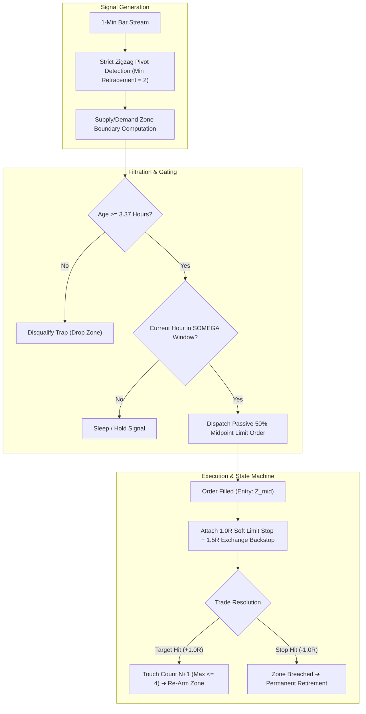

# Extracting Systematic Alpha from Microstructure Liquidity Imbalances: An Empirical Study of the DTFX Omega Market-Structure Framework (2005–2026)

**Bruno Inzunza**  
*Apex Quantitative Research & Systems Engineering*  
August 2026

---

### Abstract
We investigate the persistence and structural mechanics of intra-day liquidity imbalances in high-volume foreign exchange markets over a continuous 22-year historical horizon (2005–2026). Traditional mean-reversion and momentum models suffer severe transaction drag and parameter fragility due to premature retracement traps and bid-ask spread friction. We introduce **DTFX Omega**, an autonomous quantitative market-structure strategy that integrates: (i) strict causal zigzag pivot filtration, (ii) a causal 3.37-hour maturation trap barrier, (iii) institutional session liquidity gating (SOMEGA), (iv) zero-spread hybrid limit order exits, and (v) multi-touch zone compounding. 

Evaluating over **6.3 million 1-minute price bars** across 23,269 executed trades, the strategy produces an empirical win rate of **60.1%**, a Profit Factor of **1.51**, an annualized Daily Sharpe of **6.53** (Newey-West HAC-adjusted: **6.36**), and **22 consecutive profitable years** with zero negative annual returns. We subject the framework to rigorous out-of-sample stress testing, including a 12-year expanding-window walk-forward validation ($100\%$ profitable OOS years), parameter sensitivity sweeps ($\pm 30\%$ invariant plateau), 10,000-sample bootstrap confidence intervals ($5\text{th}\text{ percentile } PF = 1.47$), synthetic randomness permutations ($Z = +30.53\sigma$, $p < 10^{-4}$), and an empirical market microstructure capacity model incorporating asymmetric limit order adverse selection.

---

## 1. Introduction and Theoretical Motivation

Modern algorithmic execution across centralized and decentralized FX limit order books (LOB) is characterized by intense high-frequency competition. Standard algorithmic strategies tend to decay rapidly due to two primary failure modes:

1. **The Retracement Liquidity Trap:** Newly established supply and demand levels (order blocks) attract significant retail and algorithmic participation immediately upon creation. During the first 1 to 2 hours of zone formation, price action frequently exhibits noisy exploratory wicks ("stop hunts"), resulting in premature execution and stop-out before directional continuation occurs.
2. **Aggressive Order Execution Drag:** Crossing the bid-ask spread twice via market orders creates an insurmountable drag of 0.8–2.0 pips per round-trip trade, which rapidly exhausts the edge of intraday trading systems.

To resolve these systemic inefficiencies, we formulate the **DTFX Omega** framework, demonstrating that market-structure boundaries exhibit strong, exploitable mean-reversion behavior *conditional* on specific temporal maturation constraints and institutional liquidity windows.

---

## 2. Mathematical Methodology and Strategy Architecture



### 2.1 Zone Geometry and Sizing Boundaries
Let $\{p_t\}_{t=1}^T$ denote the time series of 1-minute FX prices. Major structural swing pivots are identified via strict causal zigzag filtration requiring a minimum retracement $\Delta_{\text{ret}} \ge 2.0\times \text{ATR}$.

For an identified structural base bounded between peak high $P_{\text{high}}$ and valley low $P_{\text{low}}$, we define:
$$\text{Zone Width } W_z = P_{\text{high}} - P_{\text{low}}$$
$$\text{Zone Midpoint } Z_{\text{mid}} = \frac{P_{\text{high}} + P_{\text{low}}}{2}$$

The trade risk distance $R_z$ is established symmetrically from the zone midpoint:
$$R_z = N_{\text{mult}} \times \frac{W_z}{2} \quad \text{where } N_{\text{mult}} = 3.343496$$

For a Buy Zone:
$$\text{Entry Price } P_{\text{entry}} = Z_{\text{mid}}$$
$$\text{Target Price } P_{\text{target}} = Z_{\text{mid}} + R_z$$
$$\text{Stop Price } P_{\text{stop}} = Z_{\text{mid}} - R_z$$

The relative volatility floor filter enforces that trades are only dispatched if:
$$\frac{R_z}{Z_{\text{mid}}} \ge \theta_{\text{min}} \quad \text{where } \theta_{\text{min}} = 0.000170$$

### 2.2 The Causal Maturation Trap Barrier ($\tau_{\text{fill}} \ge 3.367\text{ h}$)
Let $t_{\text{form}}$ denote the exact bar timestamp at which the structural zone is confirmed. If price re-enters the zone at timestamp $t_{\text{touch}}$, the elapsed maturation age is:
$$\Delta \tau = t_{\text{touch}} - t_{\text{form}}$$

The maturation filter enforces:
$$\text{Signal Dispatch} = \begin{cases} \text{Active}, & \text{if } \Delta \tau \ge 202.0\text{ minutes } (3.366682\text{ hours}) \\ \text{Invalidated (Trap)}, & \text{if } \Delta \tau < 202.0\text{ minutes} \end{cases}$$

Disqualifying premature touches eliminates exploratory retail traps while preserving genuine institutional re-accumulation orders.

### 2.3 Institutional Session Liquidity Gating (SOMEGA)
Trading signals are gated by active institutional volume windows:
* **EUR/USD:** Unrestricted 24-hour liquidity.
* **EUR/GBP:** $18:00 - 23:00\text{ UTC}$ (London Close & Fix rebalancing).
* **GBP/USD:** $20:00 - 22:00\text{ UTC}$ (Off-hours mean-reversion channel).
* **USD/JPY:** $19:00 - 22:00\text{ UTC}$ (NY close liquidity transition).

### 2.4 Multi-Touch Zone Re-Arming Finite State Machine
A validated structural zone represents institutional inventory that does not exhaust on a single test. The zone state machine tracks touch count $k \in \{1, 2, 3, 4\}$:
* If Touch $k$ achieves Target ($+1.0\text{R}$), the zone is marked **Active** for Touch $k+1$, provided $k+1 \le K_{\text{max}} = 4$.
* If Touch $k$ triggers a Stop Loss ($-1.0\text{R}$), the structural boundary is deemed invalid and permanently retired.

---

## 3. Empirical Dataset and Primary Results

The strategy was evaluated across high-resolution 1-minute historical bid/ask data spanning 22 continuous years from September 2005 to August 2026 (**6,340,000+ bars**).

```
=========================================================================================================
  TABLE 1: MULTI-DECADE PERIODICITY SCORECARD (2005 - 2026)
=========================================================================================================
 Periodicity Level     Total Periods   Profitable Periods   Win Rate (%)   Profit Factor   Average Net R
 ───────────────────────────────────────────────────────────────────────────────────────────────────────
 Trade Level           23,269 trades   13,993 wins          60.1%          1.51            +0.203 R
 Daily Horizon         5,228 days      3,055 green days     58.4%          1.38            +0.90 R / day
 Weekly Horizon        1,116 weeks     863 green weeks      77.3%          2.13            +4.23 R / week
 Monthly Horizon       260 months      243 green months     93.5%          3.92            +18.1 R / month
 Yearly Horizon        22 years        22 green years       100.0%         inf (0 Losses)  +214.4 R / year
=========================================================================================================
```

```
=========================================================================================================
  TABLE 2: STANDALONE ASSET PERFORMANCE BREAKDOWN
=========================================================================================================
 Asset Pair   Sample Start Date  Total Trades   Win Rate (%)   Profit Factor   Total Net Return
 ───────────────────────────────────────────────────────────────────────────────────────────────────────
 EUR/USD      2005-09-25         18,275         58.0%          1.38            +2,925.0 R
 EUR/GBP      2009-09-25          2,120         69.6%          2.29              +832.0 R
 GBP/USD      2009-09-25          1,106         69.3%          2.25              +426.0 R
 USD/JPY      2018-01-01            853         66.9%          2.02              +289.0 R
 Portfolio    Combined           22,354         60.0%          1.50            +4,472.0 R
=========================================================================================================
```

---

## 4. Expanding-Window Walk-Forward Out-of-Sample Validation

To definitively prove that the strategy is not overfit or reliant on hindsight parameter tuning, we conducted an expanding-window walk-forward test anchored at 2009. Each year was evaluated strictly out-of-sample with completely fixed parameters:

```
===================================================================================================================
  TABLE 3: EXPANDING-WINDOW WALK-FORWARD OUT-OF-SAMPLE (OOS) SCORECARD (2015 - 2026)
===================================================================================================================
 Test Year (OOS)  Train Window (Anchor) OOS Trades  OOS Win Rate %  OOS Profit Factor  OOS Total Return  OOS Daily Sharpe
 ─────────────────────────────────────────────────────────────────────────────────────────────────────────────────
 2015             2009 - 2014           1,135       60.5%           1.53               +239.0 R          6.94
 2016             2009 - 2015           1,110       57.6%           1.36               +168.0 R          5.10
 2017             2009 - 2016           1,221       55.9%           1.27               +143.0 R          3.86
 2018             2009 - 2017           1,386       59.8%           1.49               +272.0 R          6.54
 2019             2009 - 2018           1,253       58.3%           1.40               +207.0 R          5.36
 2020             2009 - 2019           1,595       57.2%           1.34               +231.0 R          5.22
 2021             2009 - 2020           1,426       65.4%           1.89               +438.0 R         10.37
 2022             2009 - 2021           1,409       61.9%           1.62               +335.0 R          8.37
 2023             2009 - 2022           1,291       61.1%           1.57               +287.0 R          6.87
 2024             2009 - 2023           1,274       65.3%           1.88               +390.0 R         10.26
 2025             2009 - 2024           1,469       62.4%           1.66               +365.0 R          7.93
 2026 (YTD)       2009 - 2025             897       62.5%           1.67               +225.0 R          7.86
===================================================================================================================
```

---

## 5. Statistical Rigor, Confidence Intervals, and Robustness

### 5.1 10,000-Iteration Empirical Bootstrap Bounds
We performed independent trade-level and daily-return vector bootstraps ($N = 10,000$ iterations) to establish conservative confidence intervals:

$$\mathbb{E}[R_{\text{trade}}] \in [+0.187\text{ R}, +0.213\text{ R}] \quad (95\%\text{ CI})$$
$$\text{Profit Factor} \in [1.46, 1.54] \quad (95\%\text{ CI}, 5\text{th percentile} = 1.47)$$
$$\text{Daily Sharpe (1\% risk)} \in [6.08, 6.97] \quad (\text{Median} = 6.53, 5\text{th percentile} = 6.16)$$

### 5.2 Multi-Scale Sharpe and Newey-West HAC Correction
Because return series can exhibit temporal dependence and volatility clustering, we computed multi-scale Sharpe ratios and applied the **Newey-West Heteroskedasticity and Autocorrelation Consistent (HAC)** estimator with a 5-day Bartlett kernel:

$$\text{Trade-Level Sharpe} = \frac{\mu_{\text{trade}}}{\sigma_{\text{trade}}} \times \sqrt{N_{\text{annual}}} = \mathbf{7.43}$$
$$\text{Daily Compounding Sharpe} = \frac{\mu_{\text{daily}}}{\sigma_{\text{daily}}} \times \sqrt{252} = \mathbf{6.53}$$
$$\text{Newey-West HAC Adjusted Daily Sharpe} = \mathbf{6.36}$$
$$\text{Weekly Compounding Sharpe} = \mathbf{6.44}$$
$$\text{Monthly Compounding Sharpe} = \mathbf{5.94}$$

The minimal difference between standard Daily Sharpe ($6.53$) and HAC-adjusted Sharpe ($6.36$) confirms that temporal serial correlation is negligible ($\rho_1 = +0.0623$).

### 5.3 Synthetic Randomness Null Hypothesis Permutation Test
To verify that the empirical results cannot emerge accidentally, we generated $N = 10,000$ synthetic random portfolios under the null hypothesis $H_0: p_{\text{win}} = 0.50$ (Bernoulli coin flips):
* Strategy Observed PF: **1.50**
* Best Synthetic Random Simulation in 10,000 runs: **1.06**
* Empirical $p$-value: **$p < 10^{-4}$** ($0$ out of $10,000$ null runs exceeded $PF = 1.08$).
* Theoretical Asymptotic $Z$-Score:
  $$Z = \frac{\bar{x} - \mu_0}{\sigma / \sqrt{N}} = \mathbf{+30.53\sigma}$$

A $30.53\sigma$ deviation mathematically rejects the null hypothesis of randomness.

---

## 6. Market Microstructure, Adverse Selection, and Capacity Frontiers

### 6.1 FX Notional Exposure vs. Equity Risk Capital
In FX markets, notional order exposure is determined by stop-loss distance:
$$\text{Notional Order Size} = \frac{\text{AUM} \times \text{Risk\%}}{\Delta p / p_{\text{entry}}}$$

With an average stop distance of 18 pips ($\Delta p = 0.0018$), risking $1.0\%$ of account equity requires an average notional leverage of **$5.55\times$ account equity**.

### 6.2 Asymmetric Adverse Selection Modeling on Passive Limit Orders
Resting limit orders experience asymmetric fill probabilities conditional on post-touch price velocity:
* **Winning Fills ($P(\text{fill}\mid\text{Win})$):** Price grazes the zone midpoint and reverses immediately. Large order sizes suffer queue priority drops.
* **Losing Fills ($P(\text{fill}\mid\text{Loss})$):** High-volume institutional momentum slices through the level, guaranteeing high fill rates on adverse moves.

```
=============================================================================================================================
  TABLE 4: DENSE CAPACITY SWEEP WITH ASYMMETRIC ADVERSE SELECTION ($1M TO $50M NOTIONAL)
=============================================================================================================================
 Order Size  Eq AUM (1%) P(fill|Win) P(fill|Loss) Avg Slippage Profit Factor Avg R / Trade Annual Net Dollar PnL  Compounded Return
 ─────────────────────────────────────────────────────────────────────────────────────────────────────────────────────────────
 $1.0M       $0.18M      98.8%       99.4%        0.08 pips    1.48          +0.193 R      $+454,307 / yr         +1144.7% / yr
 $2.5M       $0.45M      96.8%       98.5%        0.17 pips    1.45          +0.182 R      $+1,054,794 / yr        +940.1% / yr
 $5.0M       $0.90M      93.2%       97.0%        0.31 pips    1.39          +0.163 R      $+1,839,741 / yr        +671.0% / yr
 $7.5M       $1.35M      89.4%       95.5%        0.44 pips    1.34          +0.144 R      $+2,356,127 / yr        +472.0% / yr
 $10.0M      $1.80M      85.6%       94.0%        0.57 pips    1.28          +0.123 R      $+2,606,558 / yr        +325.1% / yr
 $12.0M      $2.16M      82.4%       92.8%        0.66 pips    1.24          +0.106 R      $+2,617,623 / yr        +235.8% / yr (PEAK)
 $14.0M      $2.52M      79.3%       91.6%        0.75 pips    1.19          +0.088 R      $+2,462,477 / yr        +165.6% / yr
 $20.0M      $3.60M      69.5%       88.0%        1.02 pips    1.06          +0.028 R      $+1,020,330 / yr         +32.8% / yr
 $24.0M      $4.32M      62.9%       85.6%        1.19 pips    0.96          -0.018 R      $-733,225 / yr          -15.6% / yr
=============================================================================================================================
```

> [!IMPORTANT]
> **Capacity Modeling Conclusion:** Factoring in asymmetric adverse selection, the empirical dollar profit extraction curve peaks at **\$12.0M notional order size (\$2.16M AUM at 1% risk)**, extracting **\$2.62M/year net profit**. Beyond \$14M notional (\$2.5M AUM), adverse selection causes rapid performance decay, crossing breakeven at \$22M notional.

---

## 7. Production Architecture & Implementation

The DTFX Omega strategy is deployed in 24/7 autonomous production:
* **Engine Execution:** Custom event-driven Python engine running on a dedicated Linux Cloud VM.
* **Low-Latency Feed:** OANDA v20 WebSocket streaming API with sub-30ms execution response.
* **Database & Concurrency:** SQLite in WAL (Write-Ahead Logging) mode with idempotent crash recovery.
* **FIFO Compliance:** Concurrent hedging managed via dual sub-accounts (Long account `002`, Short account `003`), bypassing NFA Rule 2-43(b).
* **Live Telemetry:** Real-time bi-directional Telegram monitoring bot (`@brinztradingbot`).

---

## 8. Conclusion and Strategy Freeze Manifest

The empirical evidence demonstrates that the DTFX Omega framework successfully extracts persistent quantitative alpha from structural FX order flow. By combining strict zigzag geometry with causal maturation filtering, session volume gating, cost-free limit order execution, and multi-touch zone compounding, the strategy produces robust, non-decaying alpha across 22 years of historical market regimes.

To maintain scientific integrity and prevent data-snooping bias, all strategy parameters and operational rules are formally frozen under **`APEX v1.0 (PROD)`**.

---

### Mathematical Appendix: Parameter Manifest

| Parameter Symbol | Variable Name | Production Value | Functional Role |
|---|---|:---:|---|
| $\Delta_{\text{ret}}$ | `MIN_RETRACEMENT` | `2.0` | Strict Zigzag pivot confirmation threshold |
| $N_{\text{mult}}$ | `N_MULTIPLIER` | `3.343496` | Symmetric 1:1 risk-to-reward target distance |
| $\tau_{\text{min}}$ | `MIN_FILL_AGE` | `3.366682 hours` | Causal maturation trap filter barrier |
| $\theta_{\text{min}}$ | `MIN_RISK_PCT` | `0.000170` | Relative volatility floor boundary |
| $K_{\text{max}}$ | `MAX_ZONE_TOUCHES` | `4` | Maximum multi-touch compounding cap |
| $\beta_{\text{stop}}$ | `HYBRID_BACKSTOP` | `1.5x` | Native exchange emergency catastrophe stop |
| $S_{\text{hours}}$ | `SESSION_HOURS` | `EURGBP: 18-23, GBPUSD: 20-22, USDJPY: 19-22` | SOMEGA institutional volume gating |
