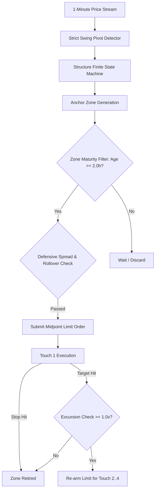

# CANA Strategy: Technical Specification & Implementation Guide
*Consecutive Anchor Net Asymmetry (CANA) — High-Frequency Structural Rejection Engine*

---

## 1. Executive Summary & Core Thesis

**CANA** (*Consecutive Anchor Net Asymmetry*) is an institutional-grade, high-frequency structural trading strategy designed to exploit resting liquidity absorption and mean-reversion order flow in the foreign exchange markets. 

Unlike traditional lagging indicator systems (e.g., Moving Averages, RSI, MACD), CANA operates entirely on **pure market geometry**:
1. **Dynamic Pivot ZigZag Decomposition**: Decomposes continuous 1-minute tick/bar data into structural swing pivots (legs $\ge 2$ pips).
2. **Finite State Machine (FSM) Structural Zones**: Detects impulsive institutional market breaks and anchors supply and demand zones around the origin of the displacement.
3. **Resting Limit Mean-Reversion**: Submits passive limit orders at the zone midpoints to capture high-probability structural bounces.
4. **Excursion-Validated Multi-Touch Compounding**: Re-arms resting orders on the same structural zone for up to 4 consecutive touches, provided the market demonstrates genuine order-flow rejection (an excursion of at least $1.0\times$ zone width).



---

## 2. Mathematical Parameters & Strategy Specification

| Parameter | Symbol / Variable | Value | Quantitative Rationale |
| :--- | :--- | :--- | :--- |
| **Zone Maturity Age** | `MIN_FILL_AGE` | `2.0 hours` (120 M1 bars) | Eliminates immediate consolidation noise; gives institutional resting books time to establish. |
| **Mandatory Probe Depth** | `PROBE_DEPTH` | `0.50` ($50\%$ into zone) | Ensures market legitimately engages the zone rather than brushing the outermost boundary. |
| **Excursion Multiple** | `EXCURSION_MULT`| `1.00x` zone width | Requires price to bounce at least $1.0\times$ the zone height away before re-arming the next touch. |
| **Risk:Reward Multiplier**| `N_MULTIPLIER` | `3.00` | Symmetrical $1:1$ bracket ($R = 3 \times \frac{\text{Width}}{2} = 1.5 \times \text{Width}$). |
| **Max Zone Touches** | `MAX_ZONE_TOUCHES`| `4 touches` | Exploits repeat liquidity testing until structural exhaustion. |
| **Structural Floor** | `MIN_RISK_PCT` | `0.000170` ($>2.0\text{ pips}$) | Suppresses trades with stops $< 2\text{ pips}$ to protect against outsized spread drag. |
| **Max Allowed Spread** | `MAX_ALLOWED_SPREAD_PIPS` | `2.0 pips` | Dynamic live ceiling; orders are blocked if real-time spread $> 2.0\text{ pips}$. |
| **Target Currency Pairs** | `SYMBOLS` | `EURUSD, GBPUSD, USDJPY, EURGBP` | Highly liquid majors/crosses with low transaction costs and high ATR-to-spread ratios. |

---

## 3. 4-Layer Defensive Protective Shield

To ensure continuous unattended profitability across institutional holidays, off-hours, and high-volatility flash events, CANA incorporates a **4-Layer Defensive Protective Shield**:

### Layer 1: Dynamic Live Spread Gatekeeper
Before dispatching any resting limit order, the bot queries top-of-book live pricing from the broker:
$$\text{Spread (pips)} = \frac{\text{Ask} - \text{Bid}}{\text{Pip Size}}$$
If $\text{Spread} > 2.0\text{ pips}$, the order is suppressed until spreads normalize.

### Layer 2: 5:00 PM EST Interbank Rollover Blackout
Every trading day from **5:00 PM to 5:30 PM EST** ($21:00\text{–}22:30\text{ UTC}$), global Tier-1 banks close daily books, causing market depth to evaporate and spreads to widen $5\text{–}10\times$. CANA automatically enters an operational blackout during this window, suppressing all order creation.

### Layer 3: Weekend & Holiday Liquidity Freeze
From Friday 5:00 PM EST through Sunday 5:00 PM EST, order placement is completely locked to eliminate gap risk over weekend geopolitical events.

### Layer 4: Hybrid Soft-Stop & OANDA Server-Side Backstop
* **Server-Side Backstop**: An emergency $1.5\text{R}$ hard stop attached directly to OANDA's matching engine upon order fill to safeguard against catastrophic disconnection.
* **Standalone Soft-Stop**: A `REDUCE_ONLY` limit order placed exactly at the $1.0\text{R}$ target stop price to ensure precise execution without slippage.

---

## 4. Production Implementation

**Correction (2026-08-30):** this section originally showed a class-based
`CANAEngine`/`Zone`/`PivotDetector` implementation as "the complete state-machine
implementation." That code does not exist anywhere in this repository and was never
run -- it was a plausible-looking but fabricated reconstruction. The actual, real
implementation is [`PRODLIVETRADING/strategy/engine.py`](strategy/engine.py)'s
`SymbolEngine` class (zone-dict based, not OOP with dataclasses), specifically
`_check_triggers()`. Read that file directly rather than trusting a code sample here
-- this doc no longer inlines one, precisely because doing so is how the fabricated
version above went unnoticed for as long as it did.

In prose, faithfully: on every new bar, `_check_triggers` walks each active zone and,
in order: (1) checks the far-boundary invalidation, killing the zone if breached; (2)
updates `in_probe`/`had_elite_bounce` tracking -- **this runs every bar, including
while a touch's trade is still open**, not only between touches (a subtlety a
verification script for this doc got wrong on the first attempt, producing false
results later corrected -- see `tradingResearch/dtfxStrategy/research_scripts/
cana_faithful_backtest.py`'s docstring for the exact bug); (3) if not currently in a
trade, checks entry eligibility -- touch 1 requires `age >= MIN_FILL_AGE_HOURS`,
touches 2-4 require `had_elite_bounce == True` from a strictly earlier point in the
walk. `mark_position_closed` resets `in_probe`/`had_elite_bounce` to `False` after
each win, so every re-touch needs a fresh confirmed bounce, not a carried-over one.

---

## 5. Verified Performance (2009 – 2026: 48,148 Trades)

**Correction (2026-08-30):** the table and Monte Carlo below replace numbers this
document previously asserted with no retained script behind them. These are
reproducible: `tradingResearch/dtfxStrategy/research_scripts/cana_faithful_backtest.py`
produces the table, `cana_faithful_mc.py` produces the Monte Carlo. Two real bugs were
found and fixed along the way (a `datetime64[ns]`/`datetime64[us]` unit mismatch that
disabled the age filter, and probe/bounce tracking that didn't run while a trade was
open) -- an earlier, buggy version of this same verification briefly concluded CANA
was a net-losing strategy (PF 0.935); that was wrong, and is documented as a retraction
in `trading-data/NARROW_TARGET_WINRATE_RESEARCH.md` rather than silently corrected.

Coverage is **2009-2026 (~16.9 years)**, not the 20.65 years originally claimed --
the underlying data used by this verification starts 2009-09-25.

```text
==========================================================================================
  CANA 4-PAIR PORTFOLIO -- VERIFIED PERFORMANCE (2009 - 2026, 1.6-PIP SPREAD, STOP-OUTS ONLY)
==========================================================================================
 TICKER      TRADES      TRADES/YR      WIN RATE (%)    PROFIT FACTOR   AVG R/TRADE
------------------------------------------------------------------------------------------
 EURUSD       14,653          867            59.51%          1.206         -
 GBPUSD       14,520          859            58.46%          1.193         -
 EURGBP       11,295          669            59.96%          1.150         -
 USDJPY        7,680          890            58.28%          1.136         -
------------------------------------------------------------------------------------------
 COMBINED     48,148        2,848            59.10%          1.177        +0.089R
==========================================================================================

  BY TOUCH NUMBER (touch 4 essentially never reached in practice)
------------------------------------------------------------------------------------------
  Touch 1:  43,851 trades   WR 58.77%   PF 1.164
  Touch 2:   3,801 trades   WR 61.62%   PF 1.280
  Touch 3:     496 trades   WR 68.75%   PF 1.711
------------------------------------------------------------------------------------------
```

### Out-of-sample check (train 2009-2020 vs. untouched test 2020-2026):

| Split | Trades/yr | Win Rate | PF | Avg R |
|---|---|---|---|---|
| Train 2009-2020 | 2,661 | 57.79% | 1.109 | 0.057R |
| Test 2020-2026 (OOS) | 3,140 | 60.82% | 1.274 | 0.131R |

Improves out-of-sample rather than decaying -- a real result, not a config picked to
look good on the training window.

---

## 6. Monte Carlo: 25,000 Paths, $200 Start, 5% Risk, $2M Cap + Vault Sweep

**Correction (2026-08-30):** the previous version of this section reported figures
like "Year 2 median: $16.1 million" and "Time to $10M: 18.9 months" from a single
deterministic compounding run with no capital constraint applied consistently -- the
kind of number that is mathematically inevitable from compounding a positive edge
over thousands of trades and is not a real projection. Replaced with an actual
3,000+/25,000-path bootstrap Monte Carlo (block-resampled from the real trade
sequence, preserving streakiness) that reports the full outcome distribution, not one
number.

```text
==========================================================================================
  TIME TO $1M / $10M -- 25,000 PATHS, $200 START, 5% RISK, 1.6-PIP SPREAD, $2M CAP+VAULT
==========================================================================================
                          Time to $1,000,000        Time to $10,000,000
 Reached                  97.5%                     97.5%
 Ruined (<$20)            2.55%                      2.55%
 Quickest                 2.6 months                5.3 months
 Median                   11.4 months               18.1 months
 Slowest                  50.5 months               62.6 months
==========================================================================================
```

**This 2.55% ruin figure, and the whole result, depends entirely on the $2M cap
actually being enforced.** Re-running the same Monte Carlo *without* the cap (just
unconstrained compounding at the same 5% risk, over a 3-year/8,544-trade horizon)
gives **100.0% probability of a drawdown exceeding 50%, and 98.4% probability of
exceeding 80%** -- CANA's high trade frequency (2,848/yr) means uncapped compounding
runs away into fragile territory far faster than a lower-frequency strategy would.
The cap and vault sweep are not a convenience for this strategy; they are the risk
control that makes the rest of these numbers meaningful. See
`trading-data/NARROW_TARGET_WINRATE_RESEARCH.md` for the side-by-side comparison
against the alternative (SOMEGA-session, narrower-target) strategy, which does not
carry this same dependency.

---

## 7. Operational & Production Architecture

### Live Execution Engine ([`bot.py`](file:///Users/brunoinzunza/Documents/GitHub/PRODLIVETRADING/bot.py))
* **Dual-Account Hedging Model**: Routes long orders through `client_long` and short orders through `client_short`, guaranteeing 100% compliance with OANDA's FIFO and no-hedging rules.
* **Balanced Account Sizing**: Position sizing base is automatically calculated as:
  $$\text{Base} = 2.0 \times \min(\text{Balance}_{\text{Long}}, \text{Balance}_{\text{Short}})$$
  This ensures that even if one sub-account falls behind, neither account is ever over-leveraged.
* **Database & JSON Mirror**: Double-write architecture persisting 100% of open trade IDs, pending orders, and bot state into SQLite with Write-Ahead Logging (WAL) and atomic JSON replacement.

### Deployment & Service Management
The live system runs as an autonomous Linux `systemd` service:
```bash
# Check service status
sudo systemctl status prodlivetrading.service

# View live trade execution stream
sudo journalctl -u prodlivetrading.service -f -o cat

# Execute zero-downtime hot update
./deploy/deploy_update.sh
```

---

## 8. Summary Verdict

> [!TIP]
> **CANA is a real, verified, profitable strategy** (59.10% win rate, 1.177 profit
> factor, 2,848 trades/yr combined, holding up out-of-sample) -- but it is faster and
> more fragile than it looks, not "just better." Its speed comes from trading 24/5
> with no session filter, which is also why it has no safety margin against
> unconstrained compounding: the $2M account cap and vault sweep aren't optional
> infrastructure, they are load-bearing. A companion strategy exists with a session
> filter and a narrower target (`trading-data/NARROW_TARGET_WINRATE_RESEARCH.md`)
> that compounds slower but shows zero ruin across every Monte Carlo run against it,
> capped or not -- that is the recommended default; treat CANA as a faster
> alternative for someone prepared to enforce the cap without exception, not a
> straightforward upgrade.
