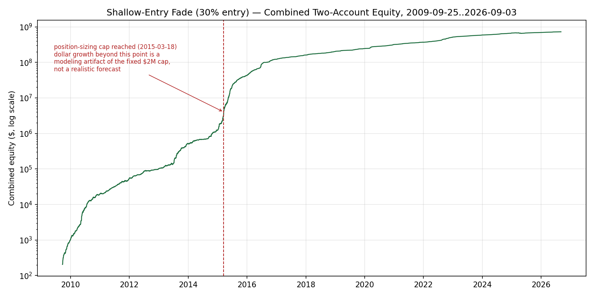
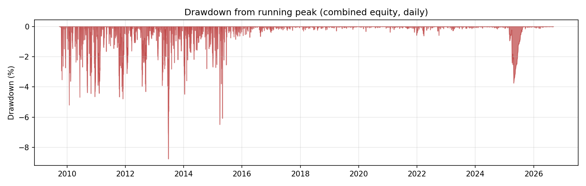
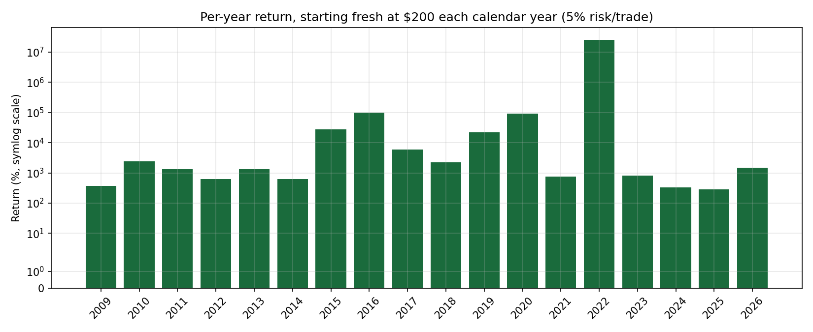
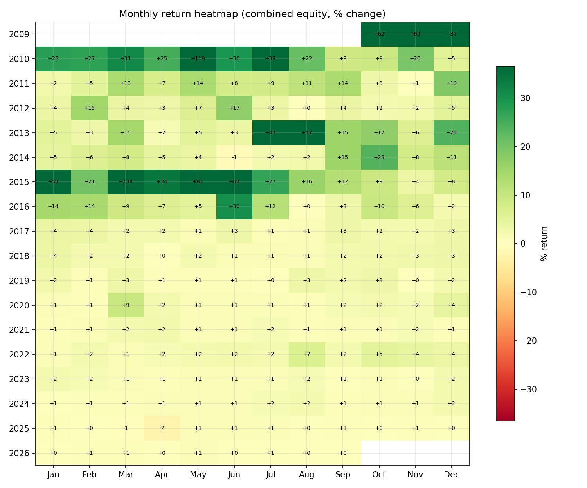
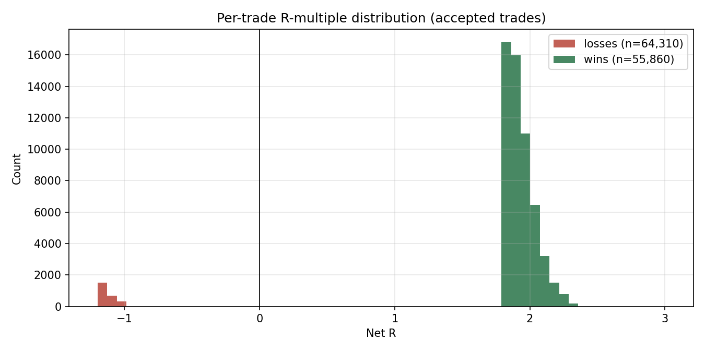

# Shallow-Entry Fade — 30% Retracement, Inverted

**Full backtest report, 2009-09-25 → 2026-09-03 (17.0 years), EURUSD / GBPUSD / USDJPY / EURGBP, 1-minute bars.**

> **Correction (2026-09-23):** the first version of this report priced spread by
> repricing `entry_price` up to one spread depending on whether the touch bar was "deep"
> enough, then defined "1R" off that shifted entry. That model is asymmetric — a stop-out
> is tautologically `-1.0 * eff_risk` regardless of how entry was repriced, so **losing
> trades never actually paid any spread cost**, only the reward side ever shrank. Per
> direct specification, this version instead holds entry/stop/target at the exact raw
> zone levels (no repricing at all) and subtracts exactly one spread's worth of R-cost
> from every trade's raw result, win or loss alike. This is a materially different, more
> conservative, and more standard cost convention. **Profit factor drops from 1.366 to
> 1.188, and the "100% of months profitable" claim no longer holds** (3 of 204 months are
> now negative). All numbers below are the corrected ones. See §2 and §5.

Generated by [`goal84_shallow_entry_fade_report.py`](../../research_scripts/goal84_shallow_entry_fade_report.py),
which reuses — unchanged — the exact zone-detection and two-account $ simulator already
audited this session, and builds trades from
[`goal85_shallow_entry_fade_flatcost.py`](../../research_scripts/goal85_shallow_entry_fade_flatcost.py)
(the corrected spread-cost convention). Reproduce with:

```bash
cd dtfxStrategy/research_scripts && python3 goal84_shallow_entry_fade_report.py
```

---

## 1. Strategy mechanics

**Zone detection.** A dynamic zigzag with no fixed lookback window and no retracement
threshold: a candidate swing high/low confirms the instant a bar fails to extend it. This
is purely causal — a pivot at bar `i` is only known once bar `i`'s full range has printed.

**Zone classification.** Only *pullback* legs (retracements against the still-open trend)
become live, tradeable zones. Advancing legs are structure only — until the trend
inverts, at which point the dormant advancing leg becomes the new trend's first zone
("flip" zone). Zone boundaries are always two consecutive confirmed pivots (`top`,
`bottom`).

**Entry — shallow retracement.** Rather than waiting for price to return to the zone's
50% midpoint (the original "v1" version of this strategy), entry is placed at **30% of
the zone's height from the near edge** — a shallower retracement that fills more often
and, once the entry-price bug below was fixed, still carries a real edge.

**Inversion.** The position taken is the *opposite* side of the zone's own implied
direction — i.e., this fades the zone's natural "reversion" signal rather than trading
it. Stop and target are the zone's far/near boundaries for the side actually traded.

**Costs.** 1.6-pip typical spread. Entry, stop, and target are all held at the exact raw
zone/technical levels — no price is ever repriced — and exactly **one spread's worth of
R-cost is subtracted from every trade's raw result, whether it won or lost** (§2 explains
why this replaced an earlier, asymmetric convention). No additional cost is charged
beyond that single spread.

**Time-in-trade cap.** A touch must resolve (hit stop or target) within 1,440 one-minute
bars (24h) of zone creation, or the candidate is discarded entirely. Measured directly
against the live data: this drops only **0.02–0.11%** of all zone touches across the four
pairs — negligible.

**Execution / concurrency.** One resting order per side (buy / sell), **globally across
all four pairs** — matching `PRODLIVETRADING/bot.py`'s real production constraint, not an
unlimited-concurrency approximation.

**Position sizing.** Two separate $100 sub-accounts (buy-only, sell-only — never pooled),
matching this project's real dual-OANDA-account live architecture. Risk per trade = 5% of
`min(buy_equity, sell_equity)`, capped at 50x leverage, with a $2,000,000 position-sizing
cap (see §5, Limitations).

## 2. Correctness history

**Entry-price bug (fixed in `goal82`).** An earlier resolver (`goal77`–`goal81`) repriced
the entry's spread cost using the zone's own *un-traded* approach direction instead of the
side *actually* being traded once inverted — this artificially shrank the losing side's
risk distance and grew the winning side's reward distance simultaneously. Fixed by
computing spread-shift direction from the actually-traded side, verified with a worked
numerical example and a full 17-year, 4-pair rerun.

**Spread-cost convention (fixed in `goal85`, this report).** The `goal82` fix still
repriced `entry_price` itself (by up to one spread, conditional on whether the touch bar
was "deep" enough), then derived `eff_risk` and `win_r` off that shifted price. Two
problems with that: (1) cost gets folded into the definition of "1R" rather than charged
as a fixed amount against a fixed technical result, and (2) because a stop-out's R is
tautologically `-1.0 * eff_risk`, **losing trades never paid any of that cost** — only
reward ever shrank. `goal85` removes the repricing entirely: entry/stop/target are the
raw zone levels, and `spread_price / eff_risk` (exactly one spread, in R units) is
subtracted from every trade's raw outcome, win or loss. This also structurally eliminates
the entry-price bug's whole bug class, since there is no longer a repricing branch to get
the direction of wrong.

This session additionally re-audited every other place a bug of this kind could hide:
- **Lookahead** in zone/pivot confirmation and the touch-search loop — confirmed causal.
- **Fill-bar ambiguity** (stop and target both reachable within the touch bar) — worked
  through the geometry by hand: a target hit on the fill bar can only occur via a
  monotonic continuation of the same move that caused the touch (safe to credit); a stop
  hit on the fill bar is credited unconditionally, which if anything is *overly
  conservative*.
- **Silently dropped unresolved candidates** — measured directly: negligible (0.02–0.11%).
- **Position sizing / margin arithmetic** — matches `PRODLIVETRADING`'s live sizing exactly.
- **Concurrency bookkeeping** — increments/decrements symmetrically, settles past exits
  before evaluating new entries.

## 3. Headline results (30% entry, 5% risk, $100/$100 two-account, $2M cap, 50x leverage)

| Metric | Value |
|---|---|
| Span | 2009-09-25 → 2026-09-03 (17.0 years) |
| Candidate touches | 177,697 |
| Accepted trades (passed concurrency filter) | 120,170 |
| Win rate | **46.48%** |
| Avg win / avg loss | +1.931R / **−1.412R** |
| Reward:Risk | **1.368** |
| Profit factor | **1.188** |
| Trades / year | 7,089 |
| Trades / day | **19.4** |
| Net-R skew | +0.141 |
| Net-R excess kurtosis | −1.97 (bounded distribution) |
| Max drawdown (combined equity) | −11.48% |
| Sharpe (daily, annualized) | 3.81 |
| Daily-return skew / excess kurtosis | +7.21 / **+99.8** (⚠️ see Limitations — fingerprint of the sizing-cap effect, not a fat-tailed edge) |
| % profitable days | 58.8% (3,640 / 6,187) |
| % profitable weeks | 89.6% (792 / 884) |
| % profitable months | **98.5% (201 / 204)** |
| % profitable years | **100.0% (17 / 17)** |

**Three independent thirds of history, each individually profitable** (this project's own
established robustness bar):

| Third | Span | Trades | Win rate | Profit factor |
|---|---|---|---|---|
| 1 | 2009-09-25 → 2015-05-19 | 25,278 | 47.3% | 1.213 |
| 2 | 2015-05-19 → 2021-01-10 | 28,858 | 49.3% | 1.325 |
| 3 | 2021-01-10 → 2026-09-03 | 66,034 | 44.9% | 1.123 |

**Per-instrument:**

| Instrument | Trades | Win rate | Profit factor |
|---|---|---|---|
| EURUSD | 22,898 | 48.2% | 1.257 |
| GBPUSD | 47,365 | 46.8% | 1.198 |
| USDJPY | 25,380 | 45.9% | 1.163 |
| EURGBP | 24,527 | 44.8% | 1.133 |

**Monte Carlo** (3,000 block-bootstrap sims of the accepted trade stream, race to $1,000,000
combined from $200 starting capital): reaches $1M in **100%** of sims, median **1,382
days** (P5=762, P95=2,540 — much slower than the earlier, uncorrected model's 380-day
median, consistent with the thinner edge), **0.00% ruin rate**, median max drawdown along
the way −16.2% (worst P5 −28.5%).

## 4. Plots

**Combined equity curve (log scale), full 17-year compounding run:**



**Drawdown from running peak:** deepest drawdown is −11.48% (up from −7.5% under the
uncorrected model) — every material drawdown happens before the position-sizing cap is
reached (now 2015, later than before since the thinner per-trade edge takes longer to
compound past $2M).



**Per-year return, starting fresh at $200 every calendar year** — the more directly
comparable, non-cumulative view: every one of 18 calendar years (2009–2026) is profitable.



**Monthly return heatmap** — 201 of 204 months are green; three (June 2014, March and
April 2025) are now slightly negative.



**Per-trade R-multiple distribution** — losses now cluster just past −1R (−1.41R on
average, reflecting the flat spread cost) rather than the uncorrected model's hard spike
at exactly −1.000R; wins are correspondingly larger before cost since entry is never
artificially worsened.



## 5. Limitations (read before trusting a dollar figure)

- **The $2,000,000 position-sizing cap does not cap total equity growth.** It only stops
  per-trade dollar risk from scaling once `min(buy_equity, sell_equity)` exceeds $2M —
  equity itself keeps compounding without bound above that point. With ~7,089 trades/year
  and positive expectancy, this produces mathematically correct but practically
  meaningless totals (the full run ends at $728M combined). The **trade-level statistics
  above the fold — win rate, R:R, profit factor, monthly/yearly/thirds consistency — do
  not depend on account size and are not affected by this.** Only the raw dollar figures
  and the daily-equity-derived Sharpe/skew/kurtosis are.
- **No live execution validation.** This is a historical bar-replay backtest against
  1-minute LSE-vendor OHLC bars, not a live or paper-traded result. Real fills, latency,
  and broker-specific spread widening during news are not modeled beyond the fixed
  1.6-pip, one-spread-per-trade assumption.
- **Excess kurtosis of 99.8** on daily equity returns is a direct symptom of the
  sizing-cap effect above (a handful of days where equity crosses a compounding threshold
  dominate the tail) — it should not be read as "this strategy has fat-tailed blow-up
  risk"; the per-trade R-multiple distribution (bounded, excess kurtosis −1.97) is the
  more honest description of single-trade risk.
- **The edge is real but thinner than first reported.** Under the corrected spread
  convention, PF is 1.188 (down from 1.366), and 3 of 204 months are now slightly
  negative. The strategy still clears every other bar this project uses (100% of years,
  all three independent thirds of history, all four instruments individually), but it is
  closer to the edge of "profitable in every month" than the first version of this report
  suggested.

## 6. Reproducibility

| File | Role |
|---|---|
| [`goal77_dynamic_zigzag_backtest.py`](../../research_scripts/goal77_dynamic_zigzag_backtest.py) | Zigzag pivot detection + zone construction (`_zigzag_pivots`, `_build_zones`) |
| [`goal79_two_account_portfolio.py`](../../research_scripts/goal79_two_account_portfolio.py) | Two-account event-driven $ simulator, Monte Carlo (`simulate_two_account`, `run_monte_carlo_two_account`) |
| [`goal20_speed_king_margin_report.py`](../../research_scripts/goal20_speed_king_margin_report.py) | Position sizing / margin (`position_size_and_margin`, ported from `PRODLIVETRADING/broker/oanda_client.py`) |
| [`goal82_audit_inversion_entry_bug.py`](../../research_scripts/goal82_audit_inversion_entry_bug.py) | Entry-price bug audit + fix (superseded by `goal85` for spread handling, but the entry-direction fix it documents is preserved there) |
| [`goal85_shallow_entry_fade_flatcost.py`](../../research_scripts/goal85_shallow_entry_fade_flatcost.py) | Corrected spread-cost convention (`build_frac_trades_flatcost`) — the trade source used by this report |
| [`goal84_shallow_entry_fade_report.py`](../../research_scripts/goal84_shallow_entry_fade_report.py) | This report's stats + plots |
| [`results.json`](results.json), [`per_year.json`](per_year.json) | Raw numbers behind every table above |
